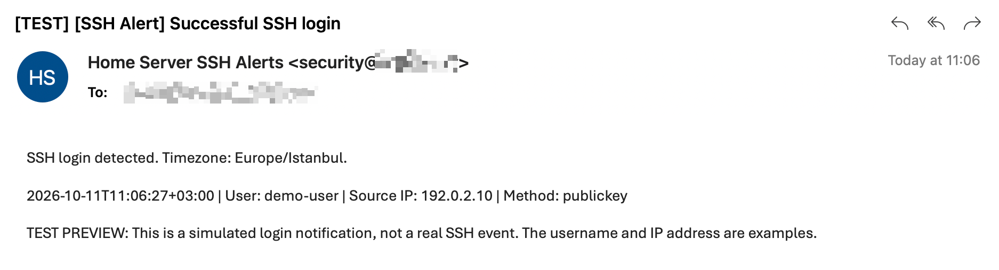
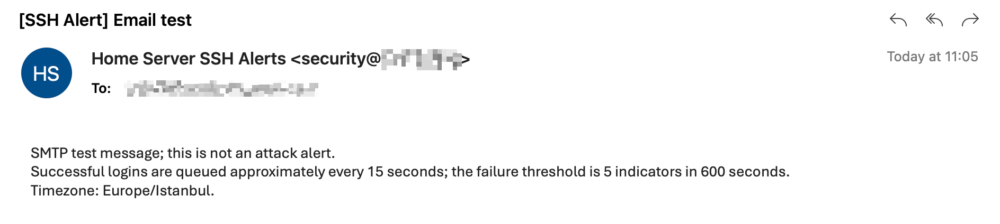

# SSH Email Alerts

Email notifications for successful SSH logins and repeated authentication failures on Linux servers. Built with the Python standard library, the systemd journal, and TLS-enabled SMTP. No third-party Python packages required.

## Features

- Checks the latest 50 SSH service records at a configurable interval (15 seconds by default).
- Reports successful logins with username, source IP, authentication method, and timestamp in your preferred timezone.
- Configurable failure threshold, time window, and per-IP notification cooldown (defaults: 5 indicators within 10 minutes, 10-minute cooldown).
- Persists the journal cursor and email queue in SQLite. Failed deliveries are retried after 60 seconds.
- Establishes a baseline on first startup without emailing historical events.
- Configurable SMTP server, TLS mode, sender address/name, and multiple recipients.
- Validate your configuration without sending email using `--check-config`.
- English by default, with Turkish available. Language and timezone are independent.
- Suppresses raw journal messages, SMTP credentials, and exception details in application output.

## Email previews

English example emails with sender and recipient details redacted.

### Successful SSH login

This test preview uses an example username and IP address; it does not represent a real login event.



### SMTP test email

The `--test-email` command sends a test message to verify your SMTP configuration.



## Requirements

Python 3.9 or later, Linux with systemd, SSH records under `ssh.service` or `sshd.service`, an SMTP account, and system timezone data (usually the `tzdata` package).

The supplied service runs as root to read the system journal and applies systemd hardening settings.

## Installation

Run these steps in the terminal of the **Linux server you want to monitor**, not on your Mac or Windows computer. If you manage the server remotely, connect to it first using your usual SSH connection. You need Git, Python 3.9 or later, and permission to run `sudo` commands.

These instructions are for a first installation. If you already run an SSH alert service, check your existing setup before starting another instance. Repeating the configuration-copy step below overwrites the existing configuration file.

### 1. Download the project

```bash
git clone https://github.com/daedricc/ssh-email-alerts.git
cd ssh-email-alerts
```

`git clone` downloads the project into a new `ssh-email-alerts` folder. `cd` enters that folder. Run the remaining steps from this directory so the source files can be found. If Git is missing, install it using your Linux distribution's package manager first.

### 2. Install the program and create a private configuration file

```bash
sudo install -d -m 755 /usr/local/lib/ssh-email-alerts
sudo install -m 644 ssh_email_alerts.py /usr/local/lib/ssh-email-alerts/ssh_email_alerts.py
sudo install -d -m 700 /etc/ssh-email-alerts
sudo install -m 600 .env.example /etc/ssh-email-alerts/config.env
```

These commands create the program and configuration folders, then copy the program and example settings into them. `sudo` runs a command with administrator privileges; it may ask for your Linux account password. The configuration folder and file are restricted to the administrator because they will contain SMTP credentials.

### 3. Enter your email settings

```bash
sudoedit /etc/ssh-email-alerts/config.env
```

This opens the configuration in your system's text editor. Replace the sample SMTP host, port, username, password, sender address, and recipient with your own settings. Set `SENDER_NAME` to the name you want recipients to see, choose `LANGUAGE=en` or `LANGUAGE=tr`, and set `TIMEZONE` to an IANA timezone such as `UTC` or `Europe/Istanbul`. Save the file and close the editor before continuing. See the configuration table below for every setting.

The sample uses Resend: use your API key as `SMTP_PASSWORD`, `resend` as `SMTP_USER`, and a sender on your verified domain. Other SMTP providers are supported with their own settings.

The configuration uses simple `KEY=value` lines. Shell commands, variable expansion, and multiline values are not supported. Keep the real configuration private; never commit it to GitHub.

### 4. Register the background service

```bash
sudo install -m 644 systemd/ssh-email-alerts.service /etc/systemd/system/ssh-email-alerts.service
sudo systemctl daemon-reload
```

The service file tells Linux how to run the program in the background. `daemon-reload` tells systemd to read the new service definition; it does not start the program yet.

### 5. Validate settings and send a test email

```bash
sudo python3 /usr/local/lib/ssh-email-alerts/ssh_email_alerts.py --check-config
sudo python3 /usr/local/lib/ssh-email-alerts/ssh_email_alerts.py --test-email
```

`--check-config` checks local syntax, required fields, email address format, language, timezone, TLS mode, and numeric ranges. It does not connect to SMTP, validate credentials with your provider, or create a state database.

Check the test-email command's result and your recipient inbox, including the spam folder. SMTP acceptance means the mail server accepted the message; it does not guarantee inbox delivery. If the test fails, review your configuration and SMTP provider settings before proceeding. The program suppresses credentials and detailed exceptions in its output.

### 6. Start the service and verify it

```bash
sudo systemctl enable --now ssh-email-alerts.service
sudo systemctl is-active ssh-email-alerts.service
```

`enable --now` starts the service immediately and enables automatic startup when the server boots. The status command should print `active`. On its first check, the service establishes a baseline without emailing historical logins. New SSH login events will then be monitored.

To inspect the latest service messages:

```bash
sudo journalctl -u ssh-email-alerts.service -n 50 --no-pager
```

## Configuration

Each installation has its own configuration file. The example contains placeholders only.

| Setting | Purpose | Example / default |
|---|---|---|
| `SMTP_HOST` | SMTP server hostname | `smtp.example.com`; default `smtp.resend.com` |
| `SMTP_PORT` | SMTP server port | `465` (default) or `587` |
| `SMTP_SECURITY` | TLS connection mode | `auto` (default), `ssl`, `starttls` |
| `SMTP_USER` | SMTP username | `YOUR_SMTP_USER` |
| `SMTP_PASSWORD` | SMTP password or provider app password | `YOUR_SMTP_PASSWORD` |
| `EMAIL_FROM` | Sender email address | `alerts@example.com` |
| `SENDER_NAME` | Optional sender display name | `SSH Alerts` |
| `EMAIL_TO` | One or more comma-separated recipients | `you@example.com,team@example.com` |
| `LANGUAGE` | Email and runtime message language | `en` (default) or `tr` |
| `TIMEZONE` | IANA timezone for login timestamps | `UTC` (default), `Europe/Istanbul` |
| `POLL_INTERVAL` | Seconds between checks | `15` |
| `FAILURE_WINDOW` | Seconds in the failure counting window | `600` |
| `FAILURE_THRESHOLD` | Failure indicators required to trigger an alert | `5` |
| `ALERT_COOLDOWN` | Seconds before the same IP can trigger another alert | `600` |

`SMTP_SECURITY=auto` uses implicit TLS on port 465 and mandatory STARTTLS on other ports. Set `ssl` or `starttls` explicitly for a custom port. Certificate verification is always enabled. Use a sender address your SMTP provider permits.

For example:

```ini
SMTP_HOST=smtp.example.com
SMTP_PORT=587
SMTP_SECURITY=starttls
SMTP_USER=YOUR_SMTP_USER
SMTP_PASSWORD=YOUR_SMTP_PASSWORD
EMAIL_FROM=alerts@example.com
SENDER_NAME=SSH Alerts
EMAIL_TO=you@example.com
LANGUAGE=en
TIMEZONE=Europe/Berlin
```

Numeric settings must be whole numbers from 1 to 86400. For example, `FAILURE_THRESHOLD=3` and `FAILURE_WINDOW=300` trigger an alert after three indicators from one IP in five minutes. `ALERT_COOLDOWN` is independent of the counting window.

For Turkish messages and Istanbul time, set `LANGUAGE=tr` and `TIMEZONE=Europe/Istanbul`. Timezones apply daylight-saving rules automatically where applicable. Unsupported languages, invalid timezones, invalid ports, and unsupported TLS modes are rejected.

Configuration is reread during checks and email delivery. Queued messages retain the language and timestamps used when they were created. CLI help is in English.

## Status and command-line options

```bash
sudo systemctl is-active ssh-email-alerts.service
sudo journalctl -u ssh-email-alerts.service -n 50 --no-pager
python3 ssh_email_alerts.py --help
```

- `--config PATH`: configuration file, default `/etc/ssh-email-alerts/config.env`. The `SSH_ALERT_CONFIG` environment variable is also supported.
- `--state-dir PATH`: persistent state directory, default `/var/lib/ssh-email-alerts`.
- `--check-config`: validate local settings without sending email or creating state.
- `--once`: perform one check and delivery attempt; exit with status 1 on journal or delivery failure.
- `--test-email`: send a test message and exit.

## Tests

```bash
python3 -m unittest discover -s tests -v
```

Unit tests cover parsing, queue behavior, configuration validation, languages, timezones, thresholds, and cooldowns. Process-level sandbox tests create temporary files, a synthetic `journalctl` executable, and an SMTP server listening only on loopback. They exercise real TLS/STARTTLS connections, sender headers, multiple recipients, temporary rejection and retry, persistent state across restarts, and certificate rejection. No external SMTP account or real SSH journal is used.

The sandbox needs `openssl` and permission to bind a local socket. Its ephemeral certificate is trusted only inside test child processes; production certificate verification is unchanged. These tests do not verify the service under a real Linux systemd installation. See [the verification report](docs/verification.md) for scope and results.

## Limitations

This tool sends notifications; it does not block IPs. One connection can produce multiple failure indicators, so the threshold is not a count of unique connections.

Only the newest 50 journal records are read per check. High traffic or a long interruption can cause intermediate events to be skipped; a log-volume alert is queued when a check reaches this limit. If journal records are removed or the cursor becomes invalid, the service reports a check failure; automatic cursor recovery is not implemented.

SMTP acceptance does not guarantee inbox delivery. A process interruption after SMTP acceptance may cause a duplicate message. If any recipient is rejected, the message remains queued and is retried for all recipients; recipients who already accepted it may receive duplicates. The queue can grow during extended SMTP outages. Pending messages are still attempted when journal reads fail. An attacker with root access can alter the service and logs.

## License

No license has been selected yet. This repository currently grants no explicit open-source license.
